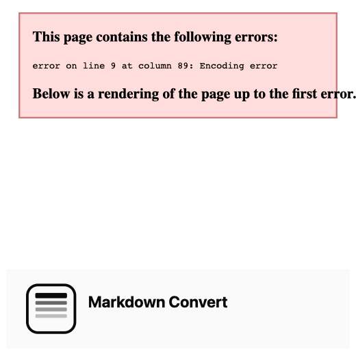

# Markdown Convert MCP

[](https://www.npmjs.com/package/@ysskrishna/markdown-convert-mcp)
[](https://github.com/ysskrishna/markdown-convert-mcp/actions/workflows/ci.yml)
[](https://nodejs.org/)
[](LICENSE)
[](https://registry.modelcontextprotocol.io/?q=io.github.ysskrishna%2Fmarkdown-convert-mcp)
[](https://www.npmjs.com/package/@ysskrishna/markdown-convert-mcp)

Convert Markdown to Slack, Microsoft Teams, Jira, and plain text with an MCP server. Supports CommonMark and GitHub-Flavored Markdown (GFM) and provides platform-specific formatting for AI agents, LLMs, and automation workflows.

Listed on the [official MCP Registry](https://registry.modelcontextprotocol.io/?q=io.github.ysskrishna%2Fmarkdown-convert-mcp) as `io.github.ysskrishna/markdown-convert-mcp`.



## Installation

Fastest path (works in most MCP hosts):

```bash
npx -y @ysskrishna/markdown-convert-mcp
```

Point your host at `npx` with args `["-y", "@ysskrishna/markdown-convert-mcp"]`, or use the plugin, skill, or host snippets below.

<a id="claude-code-plugin"></a>

<details>
<summary><b>Claude Code (plugin marketplace)</b></summary>

```text
/plugin marketplace add ysskrishna/markdown-convert-mcp
/plugin install markdown-convert-mcp@markdown-convert-mcp
```

Companion skill only:

```text
/plugin install markdown-convert@markdown-convert-mcp
```

The `markdown-convert-mcp` plugin registers the MCP server and the skill together. If you install only the skill (`markdown-convert`), add the MCP server yourself:

```bash
claude mcp add markdown-convert -- npx -y @ysskrishna/markdown-convert-mcp
```

</details>

<a id="codex"></a>

<details>
<summary><b>Codex CLI</b></summary>

```bash
codex plugin marketplace add ysskrishna/markdown-convert-mcp
codex plugin add markdown-convert-mcp@markdown-convert-mcp
```

The Codex plugin installs the skill only and does not register the MCP server. Add the server in Codex MCP settings with `npx` and args `["-y", "@ysskrishna/markdown-convert-mcp"]`.

</details>

<a id="github-copilot-cli"></a>

<details>
<summary><b>GitHub Copilot CLI</b></summary>

```bash
copilot plugin marketplace add ysskrishna/markdown-convert-mcp
copilot plugin install markdown-convert-mcp@markdown-convert-mcp
```

</details>

<a id="cursor-plugin"></a>

<details>
<summary><b>Cursor (plugin)</b></summary>

In Cursor: **Customize → Plugins → Add → From GitHub Repository** → `github.com/ysskrishna/markdown-convert-mcp`, or in Agent chat: `/add-plugin`.

The plugin includes the `markdown-convert` skill; register the MCP server under **Settings → MCP** (see [Cursor MCP](#cursor) below).

</details>

<a id="skillssh"></a>

<details>
<summary><b>skills.sh</b></summary>

```bash
npx skills add ysskrishna/markdown-convert-mcp --skill markdown-convert
```

MCP server: use the [npx](#installation) config or a host-specific MCP block below.

</details>

<a id="github-cli-gh-skill"></a>

<details>
<summary><b>GitHub CLI (gh skill)</b></summary>

Requires GitHub CLI v2.90.0 or later.

```bash
gh skill install ysskrishna/markdown-convert-mcp markdown-convert
```

</details>

<a id="clawhub-skill"></a>

<details>
<summary><b>ClawHub (per-skill)</b></summary>

```bash
clawhub install markdown-convert
```

Browse: [clawhub.ai/ysskrishna/markdown-convert](https://clawhub.ai/ysskrishna/markdown-convert). For the full MCP bundle, see [OpenClaw (ClawHub)](#openclaw-clawhub).

</details>

<a id="cursor"></a>

<details>
<summary><b>Cursor</b></summary>

Add to `~/.cursor/mcp.json` (global) or `.cursor/mcp.json` (project):

```json
{
  "mcpServers": {
    "markdown-convert": {
      "command": "npx",
      "args": ["-y", "@ysskrishna/markdown-convert-mcp"]
    }
  }
}
```

Open **Cursor Settings → MCP** and enable `markdown-convert`.

With a global install, use `"command": "markdown-convert-mcp"` instead of `npx`.

</details>

<a id="claude-code"></a>

<details>
<summary><b>Claude Code</b></summary>

```bash
claude mcp add markdown-convert -- npx -y @ysskrishna/markdown-convert-mcp
```

Add `-s user` for all projects. In a session, run `/mcp` to list tools.

</details>

<a id="claude-desktop"></a>

<details>
<summary><b>Claude Desktop</b></summary>

**Settings → Developer → Edit Config**, then restart Claude:

```json
{
  "mcpServers": {
    "markdown-convert": {
      "command": "npx",
      "args": ["-y", "@ysskrishna/markdown-convert-mcp"]
    }
  }
}
```

</details>

<a id="vscode"></a>

<details>
<summary><b>VS Code (and Copilot MCP)</b></summary>

Add to your user or workspace MCP config (for example `.vscode/mcp.json` or **GitHub Copilot → MCP** settings):

```json
{
  "servers": {
    "markdown-convert": {
      "type": "stdio",
      "command": "npx",
      "args": ["-y", "@ysskrishna/markdown-convert-mcp"]
    }
  }
}
```

Restart or reload MCP after saving.

</details>

<a id="windsurf"></a>

<details>
<summary><b>Windsurf</b></summary>

Add to `~/.codeium/windsurf/mcp_config.json` (or the MCP section in Windsurf settings):

```json
{
  "mcpServers": {
    "markdown-convert": {
      "command": "npx",
      "args": ["-y", "@ysskrishna/markdown-convert-mcp"]
    }
  }
}
```

</details>

<a id="windows-cmd"></a>

<details>
<summary><b>Windows (cmd /c wrapper)</b></summary>

Some hosts on Windows need `cmd` to resolve `npx`:

```json
{
  "mcpServers": {
    "markdown-convert": {
      "command": "cmd",
      "args": ["/c", "npx", "-y", "@ysskrishna/markdown-convert-mcp"]
    }
  }
}
```

</details>

<a id="npm-global"></a>

<details>
<summary><b>npm global</b></summary>

```bash
npm install -g @ysskrishna/markdown-convert-mcp
```

Then use `"command": "markdown-convert-mcp"` with no args in your MCP config.

</details>

<a id="mcp-inspector"></a>

<details>
<summary><b>MCP Inspector (development)</b></summary>

After `npm run build`, or against the published package:

```bash
npx @modelcontextprotocol/inspector npx -y @ysskrishna/markdown-convert-mcp
```

For a local checkout, swap in `node /absolute/path/to/markdown-convert-mcp/dist/index.js`.

</details>

<a id="openclaw-clawhub"></a>

<details>
<summary><b>OpenClaw (ClawHub)</b></summary>

Install the **bundle-plugin** from ClawHub (registers the `markdown-convert` MCP server and the companion `markdown-convert` skill):

```bash
openclaw plugins install clawhub:@ysskrishna/markdown-convert-mcp
```

Inspect before install:

```bash
clawhub package inspect @ysskrishna/markdown-convert-mcp
```

Reload OpenClaw after install.

Maintainer publish after each version tag: `python3 scripts/publish_clawhub.py plan` / `publish` (skill), then `python3 scripts/publish_clawhub.py package plan` / `package publish` (bundle). See [DEVELOPMENT.md](DEVELOPMENT.md#releasing).

</details>

## Companion skill

| Skill | Use it when | Registry |
|-------|-------------|----------|
| [`markdown-convert`](skills/markdown-convert/SKILL.md) | The agent will paste or post into Slack, Teams, Jira, or needs stripped text next. | [](https://clawhub.ai/ysskrishna/markdown-convert) |

## Tools and next hops

Each tool accepts `{ "markdown": "<source>" }` and returns converted text. Pick the tool that matches where the string will go next.

| Tool                    | Output                                                | Use when the next hop expects                 | Do not use when                                                                  |
| ----------------------- | ----------------------------------------------------- | --------------------------------------------- | -------------------------------------------------------------------------------- |
| `markdown_to_slack`     | Slack mrkdwn                                          | Slack API or Slack MCP `text` (mrkdwn)        | Composer clipboard paste; `markdown_text` fields (pass Markdown through instead) |
| `markdown_to_teams`     | HTML with inline CSS                                  | Teams paste or Graph `contentType: html`      | Adaptive Cards; this tool does not send Teams messages                           |
| `markdown_to_jira`      | ADF JSON string                                       | Jira Cloud REST v3 rich-text fields; Atlassian MCP | Wiki markup / Server v2 API; this tool does not create issues                    |
| `markdown_to_plaintext` | Plain text                                            | Any destination that needs stripped text      | —                                                                                |

Example inputs and real outputs for every tool are in [docs/tools.md](docs/tools.md).

**Limits:** Whitespace-only input returns success with an empty string. Input over 200,000 characters returns a tool error (`isError: true`), not a transport failure. Slack may truncate around 40k characters in the `text` field.

## Built and maintained by

Markdown Convert MCP is built and maintained by:

| | Name | GitHub | Role |
|---|------|--------|------|
|  | **Y. Siva Sai Krishna** | [@ysskrishna](https://github.com/ysskrishna) | Creator |

## Changelog

See [CHANGELOG](CHANGELOG.md) for release history.

## Support

If you find this project helpful:

- Star the [repository](https://github.com/ysskrishna/markdown-convert-mcp)
- [Report issues](https://github.com/ysskrishna/markdown-convert-mcp/issues)
- Submit pull requests
- [Sponsor on GitHub](https://github.com/sponsors/ysskrishna)

## License

MIT © [Y. Siva Sai Krishna](https://github.com/ysskrishna) — see [LICENSE](LICENSE) for details.

---

<p align="left">
  <a href="https://registry.modelcontextprotocol.io/?q=io.github.ysskrishna%2Fmarkdown-convert-mcp">MCP Registry</a> •
  <a href="https://www.npmjs.com/package/@ysskrishna/markdown-convert-mcp">npm</a> •
  <a href="https://github.com/ysskrishna">Author's GitHub</a> •
  <a href="https://linkedin.com/in/ysskrishna">Author's LinkedIn</a> •
  <a href="https://ysskrishna.space">Author's site</a> •
  <a href="https://github.com/ysskrishna/markdown-convert-mcp/issues">Report Issues</a>
</p>